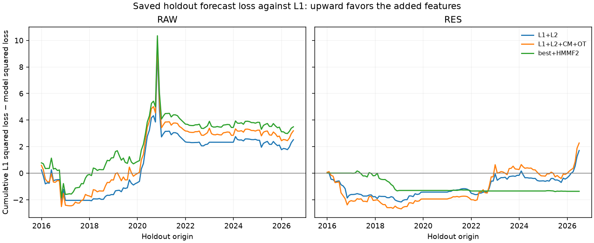

# Momenta Research

### Can cross-sectional structure improve momentum-risk forecasts?

A personal quantitative-research project by **[ycho6626](https://github.com/ycho6626)**. My contribution is an end-to-end test of that question: mathematical checks for redundant representations, a leakage-controlled forecasting and portfolio pipeline, and a placebo audit that exposed a flaw in the initial model-comparison design. The study retains the failed design, its amendment and the negative findings.

**Primary conclusion:** adding the proposed cross-sectional features to established predictors reduced holdout forecast loss by **4.62% for raw momentum** and **4.09% for residual momentum**, but did **not** pass the pre-specified 5% rule: **Holm p = 0.050728**, with both bootstrap intervals including zero. Improved net trading performance was not established.

[One-page case study](docs/case_study.pdf) · [Runnable synthetic example](examples/README.md) · [Methodology](METHODOLOGY.md) · [Research history](docs/research_history.md) · [Evidence guide](docs/results_guide.md)

## Research judgment: diagnosing a misleading comparison

**The original regularization design favored added noise.** With one shared penalty, appending four or ten pure-noise variables improved out-of-sample MSE in 78% or 82% of 200 RAW replications per block size. The added block changed the selected penalty and indirectly improved shrinkage of an overfit baseline. That made a larger model look useful without identifying information in its added features.

Before the holdout, the design was amended to sequential block penalties, exact feature exclusion and training-standardized clipping. Across **800 amended placebo replications**, every series/block-size mean incremental R² was negative; Clark–West rejection rates ranged from 3.0% to 8.5% at nominal 5%. The [superseded forecasts](results/registered_forecasts_superseded.csv), [original placebo audit](results/registered_placebos_superseded.csv) and [amended audit](results/placebo_audit.csv) remain available. This diagnosis changed how the hypothesis was tested; it did not justify selecting a favorable holdout result.

## Mathematical motivation and implementation

A long–short momentum portfolio can become risky through individual volatility, return dependence or changing factor exposure. A factor–residual variance decomposition motivates separating common exposure from residual dependence; residualizing the sorting signal does not force the resulting portfolio's factor exposure to zero.

The mathematics also identifies redundancy. Binary sign entropy is determined by breadth; average pairwise correlation can be recovered from the variance of standardized cross-sectional means; and a rank transport gap reduces to twice one minus Spearman correlation within its stated domain. These identities are [derived and property-tested](METHODOLOGY.md). Statistical-mechanics concepts motivate the representations, without assuming a physical law of markets.

The completed implementation includes:

- Monthly 1,000-stock US equity universes with permanent identifiers, corporate-action and terminal-return handling, and separate academic and tradable momentum books.
- Annual walk-forward refits, completed-target eligibility, purged inner validation, training-only transformations, sequential block penalties and exact exclusion.
- Sliced-quantile embeddings, training-fitted k-means and PCA, and forward-filtered Gaussian HMMs for secondary comparisons.
- A signed-position ledger for drift, terminal cash, next-close execution, turnover and costs.

The historical pipeline uses Python, DuckDB, Parquet, Polars, NumPy and SciPy. This public edition provides selected numerical methods, synthetic and property tests, and reviewed aggregate evidence. Licensed observations and security-level exports are excluded.

## Three stages of risk prediction

| Stage | Information set | Comparison |
|---|---|---|
| Own-volatility HAR (`L1-own`) | The book's trailing 5-, 21- and 126-day realized variance | Baseline |
| Established predictors (`L1`) | HAR plus established risk, market-state, momentum and liquidity predictors | L1 against HAR: registered secondary comparison |
| Proposed additions (`L1 + L2`) | L1 plus nine cross-sectional shape, dependence and rank-dynamics features | L1 + L2 against L1: primary hypothesis H3 |

The 127 holdout month-end origins span **31 December 2015–30 June 2026**. Targets are log 21-day realized variance after next-close execution. MSE and its improvement intervals are in squared log-variance units; the intervals below are **not** intervals for the percentage loss reduction.

**The established baseline succeeded in the holdout.** L1 reduced forecast loss relative to HAR by **18.51% for RAW and 17.63% for RES**. Both paired-bootstrap improvement intervals exclude zero, and both Holm-adjusted Clark–West p-values are below 0.0001. This secondary result concerns established predictors, not the incremental value of L2.

| Series | HAR MSE | L1 MSE | Loss reduction vs HAR | MSE improvement, 95% CI | CW p, Holm |
|---|---:|---:|---:|---:|---:|
| RAW | 0.526094 | 0.428731 | 18.51% | 0.097364 [0.001939, 0.191308] | 0.0000613 |
| RES | 0.398589 | 0.328329 | 17.63% | 0.070261 [0.017896, 0.125850] | 0.0000472 |

The design-period evidence was weaker: over 120 origins from December 2005 to November 2015, L1 increased RAW MSE by 12.19%; RES's 1.78% improvement had a bootstrap interval including zero. [Exact design and holdout comparisons](results/forecast_results.csv).

**The proposed additions did not pass the primary rule.** Their incremental improvements use L1 as the benchmark:

| Series | L1 MSE | L1 + L2 MSE | Loss reduction vs L1 | MSE improvement, 95% CI | CW p, unadjusted | CW p, Holm |
|---|---:|---:|---:|---:|---:|---:|
| RAW | 0.428731 | 0.408918 | 4.62% | 0.019813 [−0.060176, 0.111449] | 0.025364 | 0.050728 |
| RES | 0.328329 | 0.314902 | 4.09% | 0.013426 [−0.018042, 0.045394] | 0.036754 | 0.050728 |

Inference uses one-sided Clark–West tests with Holm adjustment across RAW and RES within each hypothesis, plus 5,000 paired stationary-bootstrap draws with mean block length 12 calendar months. H3 is not supported under the pre-specified 5% rule; this does not establish that the true effect is zero. [Exact primary results](results/primary_hypothesis.csv).



Upward movement favors the candidate against L1. **Descriptive concentration checks from the completed report:** RAW's total cumulative L2 loss reduction of 2.52 is concentrated in 2020 (+3.44), particularly the October 2020 origin (+5.39); excluding 2020 leaves −0.93. RES's total of 1.71 is concentrated in 2026 (+2.06); excluding 2026 leaves −0.35. These rounded values are sums of squared-loss differences, not MSEs or percentage returns. L2 is slightly worse than L1 outside those respective years.

These are descriptive, post-unblinding exploratory checks of saved errors, **not additional registered hypothesis tests**. They explain concentration without replacing the full-sample conclusion or selecting a new sample. The chart's common L1 reference also differs from the named benchmarks for secondary transport and state tests.

## Forecasting improvement is not trading profitability

Holding months are January 2016–July 2026. These are annualized Lo-adjusted Sharpe ratios after **10 bp per unit of traded notional**, with monthly execution and no collateral interest. Market impact and borrow costs are omitted.

| Volatility-targeting rule | RAW net Sharpe | RES net Sharpe |
|---|---:|---:|
| Historical volatility (BSC) | 0.3013 | −0.0384 |
| L1 forecasts | 0.1629 | −0.1487 |
| L1 + L2 forecasts | 0.1240 | −0.1524 |
| L1 + L2 + copula + transport | 0.1636 | −0.1210 |
| Frozen best feature model + filtered states | 0.1812 | −0.1450 |

The added model-based rules do not establish an improvement over BSC. No profitable-alpha claim follows. [All strategy metrics](results/strategy_results.csv), [paired Sharpe intervals](results/sharpe_differences.csv) and [cost sensitivity](results/cost_sensitivity.csv) remain available.

## Run an example and validate the evidence

Use Python 3.12 and `uv` from a source checkout:

```sh
git clone https://github.com/ycho6626/momenta-research.git
cd momenta-research
uv sync --locked
uv run --locked python examples/synthetic_walkforward.py
uv run momenta verify
uv run pytest
uv run ruff check
```

The [synthetic demonstration](examples/README.md) runs generated returns through feature construction, chronological forecasting and evaluation. It requires no credentials or downloads of market data. Its instructional outputs are separate from the frozen evidence and do not reproduce the historical study.

`verify` checks file hashes and consistency of recorded aggregate statistics. The completed licensed-data study separately passed 490 tests and reproduced 87 artifacts exactly in 60 minutes 36 seconds, excluding downloads and robustness. The public checkout does not rebuild those historical forecasts. See [reproducibility and scope](docs/reproducibility.md).

## Retained failures and limitations

The weaker design-period baseline, the shared-penalty failure and its superseded results remain visible. Empirical transport separation was 1.329 against a descriptive threshold of 2. Filtered regimes did not establish incremental value. A construction-boundary defect created unused future target pairs; it was corrected before the freeze, and the bounded rerun produced identical numerical results. [Research design](docs/research_design.md) records these outcomes.

This is an **internally frozen historical study following full-sample data-quality review**, not a prospective experiment or independently timestamped public preregistration. Final-vintage inputs, some capitalization backfills, imputed terminal returns and few independent crashes limit interpretation. The [dated research history](docs/research_history.md) distinguishes original internal records from retrospective public documentation. Robustness variants remain separate from the headline.

[Methodology](METHODOLOGY.md) · [Design and limitations](docs/research_design.md) · [Data and references](docs/data_and_references.md)
